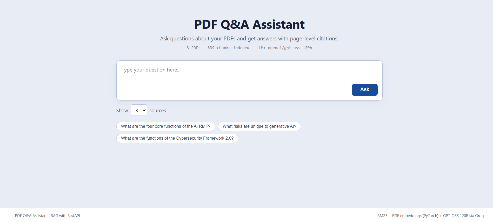
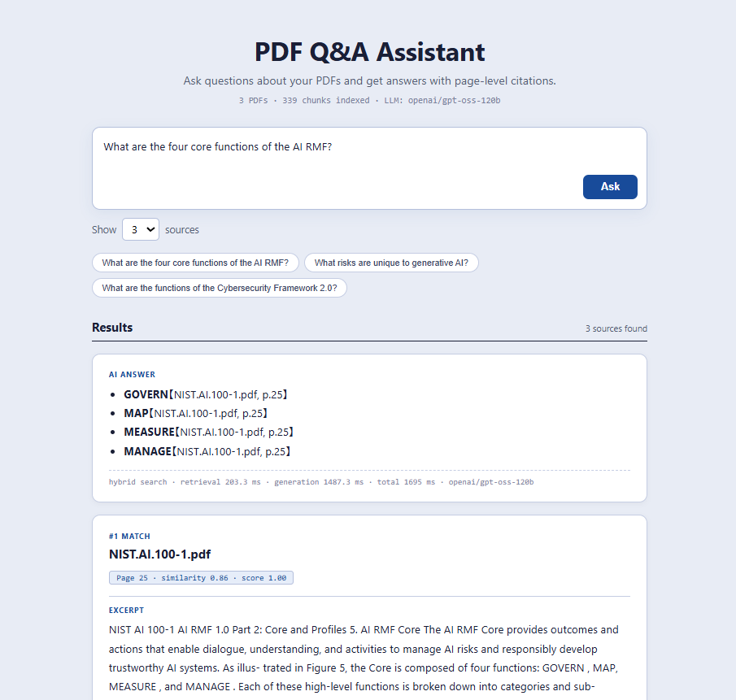
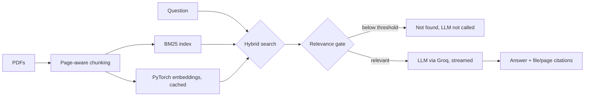

# PDF Q&A Assistant: A Hybrid-Search RAG System

[](https://github.com/‹your-username›/pdf-qa-assistant/actions)
  

Ask questions about PDF documents in plain English and get answers with the **exact file and page** as evidence.
A Retrieval-Augmented Generation (RAG) service with hybrid search (BM25 + PyTorch embeddings), streamed LLM answers, and a retrieval evaluation that was used to choose the search method and tune the relevance threshold.


| Ask a question | Streaming answer with sources |
|---|---|
|  |  |

## Why this project

LLMs answer confidently even when they are wrong. This project forces every answer to come from retrieved passages, shows the source page so the user can verify it, and refuses to answer when nothing relevant is found.

## Architecture



## Evaluation: choosing the search method

I implemented three retrieval methods and compared them instead of assuming which one is best:

| Method | How it works |
|---|---|
| **BM25** (keyword) | Scores passages by matching words, weighting rare words higher |
| **Dense** (semantic) | Compares meaning using `BAAI/bge-small-en-v1.5` embeddings (PyTorch) |
| **Hybrid** | Min-max normalises both scores and mixes them: `alpha × BM25 + (1 − alpha) × dense` |

**Method:** 9 questions written from the sample PDFs, each labelled with the correct file and page(s). A retrieval counts as a hit if one of the top-k passages comes from a correct page. I report Recall@k and MRR (mean reciprocal rank). Reproduce with `python -m evaluation.run_eval`; the full output is in [`evaluation/results.md`](evaluation/results.md).

### Results: retrieval quality (9 questions, k=5)

| Method | Recall@1 | Recall@3 | Recall@5 | MRR |
|---|---|---|---|---|
| BM25 | 0.44 | 1.00 | 1.00 | 0.72 |
| Dense | 0.56 | 0.78 | 1.00 | 0.69 |
| **Hybrid** | **0.56** | **1.00** | **1.00** | **0.76** |

**Decision: hybrid search.** It is the only method that is best or tied-best on every metric. Embeddings alone missed the correct page in the top 3 for 2 of 9 questions (Recall@3 = 0.78), and BM25 alone ranked the correct page first less often (Recall@1 = 0.44). Combining them gives Recall@3 = 1.00 and the highest MRR.

### Results: hybrid weight (alpha = weight of BM25)

| alpha | Recall@3 | MRR |
|---|---|---|
| 0.00 (dense only) | 0.78 | 0.69 |
| 0.25 | 0.89 | 0.71 |
| **0.50** | **1.00** | **0.76** |
| 0.75 | 1.00 | 0.78 |
| 1.00 (BM25 only) | 1.00 | 0.72 |

I kept `alpha = 0.5`. Alpha 0.75 has a slightly higher MRR, but the difference is one question moving up one rank on a 9-question set, which is within noise. 0.5 sits in the middle of the good range (0.5 to 0.75), so it is the safer choice than tuning to a tiny sample.

### Results: relevance gate (9 answerable, 5 unanswerable questions)

The gate skips the LLM when the best passage's similarity is below `min_similarity`.

| min_similarity | Answerable passed | Unanswerable blocked |
|---|---|---|
| 0.30 | 100% | 0% |
| 0.35 | 100% | 0% |
| 0.40 (original value) | 100% | **0%** |
| 0.45 | 100% | 60% |
| 0.50 | 100% | 80% |
| **0.55 (chosen)** | **100%** | **100%** |
| 0.60 | 100% | 100% |
| 0.65 | 100% | 100% |
| 0.70 | 89% | 100% |

**Finding:** my original threshold of 0.40 had been tuned by hand and blocked 0% of off-topic questions, so the gate was effectively disabled. Raising it to **0.55** blocks all unanswerable questions without rejecting any answerable one. I chose the lower edge of the perfect range because wrongly refusing a real question is worse than letting an off-topic one through (the LLM prompt is a second safety net that also answers "not found").

> **Caveat:** the evaluation set is small (9 answerable and 5 unanswerable questions, written by me from the sample PDFs). Treat these numbers as indicative, not as a benchmark. Recall@1 is only 0.56, so ranking at the very top is still imperfect (see Roadmap).

## Features

- Answers grounded only in the documents, with `[file.pdf, p.N]` citations
- Hybrid search (BM25 + embeddings), chosen over keyword-only and embedding-only search by measurement
- Relevance gate tuned from evaluation data: no LLM call (and no invented answer) when nothing relevant exists
- Streaming responses (Server-Sent Events) and a latency breakdown (retrieval vs. generation)
- Prompt-injection-aware prompt: retrieved text is treated as data, not instructions
- Embedding cache, typed configuration, structured logging, health endpoint
- GitHub Actions CI (ruff + pytest) runs automatically on every push

## Tech stack

| Layer | Technology |
|---|---|
| Backend | Python, FastAPI, Pydantic |
| Keyword search | BM25 (rank-bm25) |
| Semantic search | PyTorch + Hugging Face `BAAI/bge-small-en-v1.5` |
| LLM | GPT-OSS 120B via Groq (OpenAI-compatible API) |
| PDF parsing | pypdf |
| Frontend | HTML, CSS, vanilla JavaScript |
| Testing | pytest (20 tests, fakes instead of real models), ruff |
| CI | GitHub Actions |

## Quick start

```bash
git clone https://github.com/‹your-username›/pdf-qa-assistant.git
cd pdf-qa-assistant
python -m venv .venv && source .venv/bin/activate     # Windows: .venv\Scripts\activate
pip install -r requirements.txt
cp .env.example .env                                  # Windows: copy .env.example .env
# add your free Groq key from console.groq.com to .env
uvicorn app.main:app --reload
```
Open http://localhost:8000 (the first start downloads the model and builds the embedding cache).
Put your own PDFs in `documents/` and restart; every PDF there is indexed.

**Tests and lint:** `pip install -r requirements-dev.txt && ruff check . && pytest`

**Evaluation:** `python -m evaluation.run_eval`

## API

`POST /api/v1/query`

```json
{ "question": "What are the four core functions of the AI RMF?", "top_k": 3 }
```
```json
{
  "answer": "The AI RMF core has four functions: Govern, Map, Measure, Manage [NIST.AI.100-1.pdf, p.25].",
  "sources": [{ "source": "NIST.AI.100-1.pdf", "page": 25, "similarity": 0.71, "score": 0.93, "text": "..." }],
  "latency_ms": 1180.4, "retrieval_ms": 85.2, "generation_ms": 1090.7,
  "mode": "hybrid", "model": "openai/gpt-oss-120b"
}
```
`POST /api/v1/query/stream` returns the same data as Server-Sent Events (`sources`, `token`, `done`).
`GET /health` shows indexed documents and model configuration. Interactive docs: `/docs`.

## Project structure

```
app/            config, API routes, PDF processing, embedding, retrieval, LLM generation
static/         web UI (HTML, CSS, JS)
evaluation/     labelled questions + script that measures Recall@k and MRR
tests/          unit and API tests (use fakes: no model download or API key needed)
documents/      sample PDFs (NIST AI RMF, Generative AI Profile, Cybersecurity Framework 2.0)
```

## Design decisions

- **Retrieval written from scratch instead of LangChain:** to understand and control each step (chunking, scoring, normalisation, gating). The pieces map cleanly onto LangChain components if a team standard requires it.
- **Hybrid search only in the product, all three methods in the code:** the API always uses hybrid. The retriever still supports `bm25` and `dense` modes so the evaluation script can reproduce the comparison above.
- **200-word chunks with 40-word overlap:** stays inside the embedding model's 512-token limit, so nothing is silently truncated.
- **Page-aware chunks:** every answer can be verified against a page.
- **Top 3 passages by default:** Recall@3 is 1.00 for hybrid versus 0.56 at Recall@1, so passing three passages to the LLM keeps the right one in context even when it is not ranked first.
- **Relevance gate chosen from data:** below 0.55 similarity the LLM is not called, which saves cost and avoids made-up answers.
- **Fakes in tests:** retrieval and API logic are tested without downloading models or calling the LLM, so CI takes seconds.

## Limitations

- Text-based PDFs only (scanned PDFs need OCR)
- English-focused embedding model
- No conversation memory; each question is independent
- Evaluation set is small and hand-written; Recall@1 is 0.56, so the top-ranked passage is not always the best one

## What I learned

- **Measure, don't assume.** I originally tuned the relevance threshold by hand (0.40). When I built a small evaluation set, it showed the gate blocked 0% of off-topic questions, so it was effectively switched off. Raising it to 0.55 blocked 100% of them without rejecting any real question. I now check my assumptions with data before trusting them.
- **Compare methods before choosing one.** I implemented keyword search (BM25), embedding search and a hybrid of both, then compared them. Hybrid reached Recall@3 = 1.00 versus 0.78 for embeddings alone. I also saw that a higher-MRR alpha (0.75) was within noise on 9 questions, so I kept the safer 0.5 instead of over fitting.
- **Be honest about limits.** My evaluation set is small and written by me, and Recall@1 is only 0.56. I documented this in the README and listed re-ranking as the next step, instead of presenting the numbers as a benchmark.
- **Design for testability and operations.** I tested the API and retrieval logic with fakes, so 20 tests run in seconds without downloading models or calling the LLM. Adding streaming also taught me that errors must be sent as events once the HTTP status has already been sent.

## Future Improvements

Ordered by expected impact. Each item is tied to a weakness I measured or noticed.

**Retrieval quality**
- **Cross-encoder re-ranking.** Recall@3 is 1.00 but Recall@1 is only 0.56, so the right passage is found but often not ranked first. Re-ranking the top 5 candidates with a cross-encoder should improve the top result.
- **Larger evaluation set.** Grow from 9 to 50+ labelled questions across all three PDFs, and report confidence intervals so the comparison between methods is statistically meaningful.
- **Smarter chunking.** Split on section headings instead of fixed 200-word windows, so a definition is less likely to be cut in half.

**Answer quality**
- **Answer evaluation, not only retrieval evaluation.** Measure whether answers are faithful to the retrieved text (for example with a rubric or an LLM-as-judge check), since the current evaluation only covers retrieval.
- **Conversation memory.** Rewrite follow-up questions using chat history so "and what about the second one?" works.
- **Tables and scanned PDFs.** Add table-aware extraction and OCR for scanned documents.

**Product and operations**
- **Upload PDFs from the UI**, with automatic re-indexing instead of restarting the server.
- **Persistent vector store** (for example FAISS or pgvector) so the index scales beyond a few hundred chunks.
- **Cloud deployment** on a free-tier platform with a public demo link.
- **Usage logging and monitoring** for latency, gate rejections and failed LLM calls.
- **Multilingual support**, including a multilingual embedding model so other language documents can be searched.